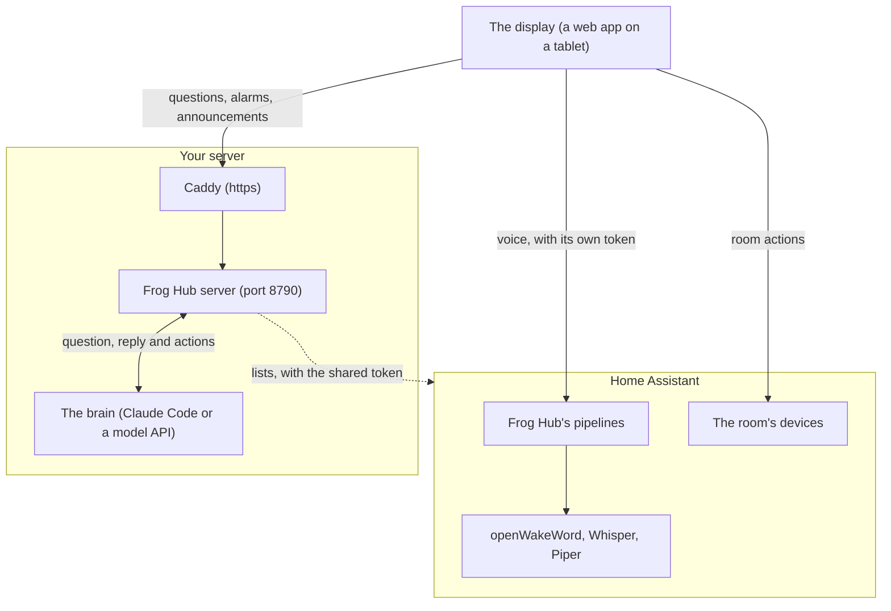
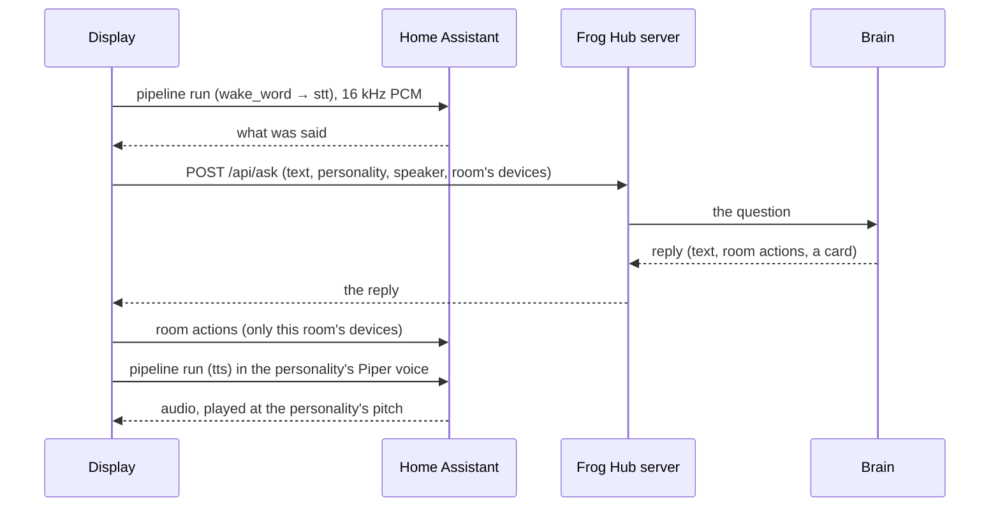

# How it fits together

- **The display** is a web app (Svelte). It talks to Home Assistant directly, with its own token, for the voice and the
  room's devices, and to the Frog Hub server for everything else. The server only talks to Home Assistant for the
  [lists](/features/lists), with the token the displays share.
- **The server** (`channel/`) serves the [HTTP API](/reference/http-api) and the assistant's tools, and keeps alarms,
  announcements, schedules, the displays' registry and the settings in `~/.config/froghub/`.
- **The brain** answers. With Claude Code, the server is an MCP channel of a long-running Claude Code session, which
  replies through a `reply` tool. With the API brain (`channel/standalone.ts`), the server calls the model itself. The
  display can't tell the difference.
- **The voice** runs in three containers (`setup/voice/compose.yaml`, Wyoming protocol): openWakeWord on 10400, Whisper
  on 10300 and Piper on 10200, used by Home Assistant's pipelines.

## A request, step by step

